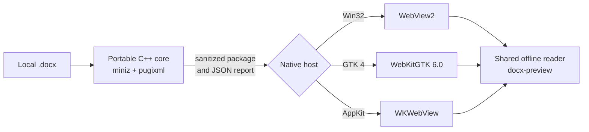

# LeanDoc

**Read the document, not the office suite.**

LeanDoc is a read-only desktop viewer for Word documents. It opens a `.docx`
as pages, never runs anything inside it, never fetches anything the document
points to, and has one button that hands the file to a real editor.


*The Linux build (GTK 4 and WebKitGTK 6.0) showing a sample report with
headings, a list, a table, a footnote, and an Arabic paragraph. The document
and the capture script are in [docs/images/screenshot-source/](docs/images/screenshot-source/).*

Windows 11 24H2 removed WordPad, and the Explorer preview for `.docx` files
needs Microsoft Office. A Windows PC without Office now has no built-in way to
read the document someone just emailed.

People who do have Word often only want to read. Word takes seconds to start
and is built for writing. LeanDoc is built for reading: it opens the file,
shows it, and gets out of the way. It is MIT licensed, like its siblings
[LeanMark](https://github.com/abooodbah/leanmark) and
[LeanRows](https://github.com/abooodbah/leanrows).

## Install

On Windows, once the package is accepted:

```powershell
winget install abooodbah.LeanDoc
```

Pending review in winget; until then, download from
[Releases](https://github.com/abooodbah/leandoc/releases).

Windows, Linux (`.deb`), and macOS builds are all on the
[Releases](https://github.com/abooodbah/leandoc/releases) page.

## Platform releases

| Operating system | Architecture | v0.1.3 artifact | Runtime |
| --- | --- | --- | --- |
| Windows 10 / 11 | x64 | [LeanDoc-v0.1.3-windows-x64.zip](https://github.com/abooodbah/leandoc/releases/download/v0.1.3/LeanDoc-v0.1.3-windows-x64.zip) | Microsoft Edge WebView2 Runtime |
| Ubuntu 24.04 and compatible | x86-64 | [LeanDoc-v0.1.3-linux-x86_64.deb](https://github.com/abooodbah/leandoc/releases/download/v0.1.3/LeanDoc-v0.1.3-linux-x86_64.deb) | GTK 4 and WebKitGTK 6.0 |
| macOS 12 or later | Intel and Apple silicon | [LeanDoc-v0.1.3-macos-universal-preview.zip](https://github.com/abooodbah/leandoc/releases/download/v0.1.3/LeanDoc-v0.1.3-macos-universal-preview.zip) | Preview, system WKWebView |

Each artifact has an adjacent `.sha256` sidecar on the
[v0.1.3 release](https://github.com/abooodbah/leandoc/releases/tag/v0.1.3).
The macOS preview also has a `.metadata.json` file that records how it was
signed. Windows ARM64 and Linux ARM64 are not part of this release.

> [!IMPORTANT]
> The Windows executable is unsigned. The macOS preview bundle is ad-hoc
> signed with the hardened-runtime flag but is not Developer ID signed or
> notarized. Windows SmartScreen or macOS Gatekeeper may therefore ask for an
> explicit trust decision. Official project binaries are limited to assets
> attached to this repository's GitHub Releases. The published checksum proves
> byte identity with the release asset; it does not replace platform code
> signing.

Check a download against its sidecar before you run it:

```powershell
Get-FileHash .\LeanDoc-v0.1.3-windows-x64.zip -Algorithm SHA256
```

```sh
sha256sum -c LeanDoc-v0.1.3-linux-x86_64.deb.sha256
```

## Package use

### Windows x64

The extracted ZIP is portable. `LeanDoc.exe`, `WebView2Loader.dll`, and the
`assets` folder must stay together. Open documents from the app, drop them on
the window, or pass them on the command line. Documents open as tabs in one
window, and a later launch hands its files to that window.

The optional per-user installer adds LeanDoc to the Start menu, to Open With,
and to Default Apps for `.docx`, `.dotx`, `.docm`, `.dotm`, `.doc`, `.rtf`, and
`.odt`. It makes LeanDoc the default only for a type that has no default app
yet. It never changes a default you or your organisation already chose.

```powershell
powershell.exe -NoProfile -ExecutionPolicy Bypass -File .\installer\install.ps1 -ValidateOnly
powershell.exe -NoProfile -ExecutionPolicy Bypass -File .\installer\install.ps1
```

It copies LeanDoc to `%LOCALAPPDATA%\Programs\LeanDoc`. Uninstalling removes
LeanDoc's files, its Start menu and Open With entries, its WebView2 data folder
under `%LOCALAPPDATA%\LeanDoc`, and restores any default it set. Uninstall in
Settings or with:

```powershell
powershell.exe -NoProfile -ExecutionPolicy Bypass -File "$env:LOCALAPPDATA\Programs\LeanDoc\uninstall.ps1"
```

The [installer notes](installer/README.md) list exactly what it writes.
`tools\leandoc-inspect.exe` in the ZIP prints the core's report for a file; it
is not put on `PATH`.

### Linux x86-64

The Debian package declares its GTK 4 and WebKitGTK 6.0 dependencies, so APT
resolves them:

```sh
sudo apt install ./LeanDoc-v0.1.3-linux-x86_64.deb
```

It installs `/usr/bin/leandoc`, a desktop entry, AppStream metadata, the icon,
and the reader assets. It offers LeanDoc for Word documents without replacing
your default app. A later launch opens its files as tabs of the running
window.

### macOS universal preview

The ZIP holds `LeanDoc.app` with Intel and Apple silicon slices. Move it to
`/Applications` or another folder. Finder offers LeanDoc as a viewer for the
same seven extensions, and documents use the system's window tabs.

Because the preview is not notarized, Gatekeeper may block the first launch.
macOS records an explicit approval under **System Settings > Privacy &
Security**. Environments that require a notarized app are not supported by
this release.

## What it renders

- `.docx`, `.dotx`, `.docm`, and `.dotm` files, including Strict OOXML.
- Paragraph and character styles with their inheritance, theme fonts and
  colours, and multi-level numbering.
- Bullets in Symbol and Wingdings fonts, mapped to the characters they show
  in Word.
- Tables with merged cells, borders, and shading.
- Pictures stored as PNG, JPEG, GIF, or BMP.
- Headers and footers, footnotes and endnotes, links, and page and section
  breaks.
- Right-to-left text: Arabic paragraphs, numbered lists, and mirrored tables,
  and Arabic and English in one paragraph.

Page view is the default. Reading view reflows the text to the window and is
one click (or Ctrl+Shift+V) away. Zoom runs from 50 to 300 percent, with fit
width. A navigation pane lists the headings, find searches the whole
document, and the System, Light, and Dark theme cycle changes LeanDoc's
chrome while the page itself stays on paper colours.

`.doc`, password-protected documents, `.rtf`, `.odt`, and files that are not
Word documents get a plain page that says what the file is, with the
open-in-editor button.

## The fidelity bar

LeanDoc does not pretend. When a document holds content it does not display,
a quiet bar above the page says so, with counts, and offers the editor:


*The Linux build with a sample draft that holds a text box and tracked
changes. The details list is open.*

- The first sentence names what is not displayed: text boxes, equations,
  charts, SmartArt, shapes, OLE objects, ActiveX controls, and imported
  content.
- The second sentence names what LeanDoc handled for you: tracked changes
  (shown as accepted), comments (hidden), macros (not run), and remote
  templates, images, and fields (not fetched).
- **Details** lists every feature and its count. The bar can be collapsed for
  a tab. It is never a modal, and it never hides itself for good.

How well LeanDoc renders is measured against Word with a fixed list of 30
documents and a five-point rubric in [docs/FIDELITY.md](docs/FIDELITY.md).
The score is not yet recorded.

## What it does not do

- Charts, SmartArt, and most text boxes are not displayed. Most equations
  display; the forms LeanDoc cannot draw show an "[Equation]" marker. The
  fidelity bar names everything that is not displayed and offers the editor.
- `.doc` (Word 97 to 2003) files are not rendered. They get a fallback page.
- LeanDoc lays out pages itself, starting from the page starts Word saved in
  the file and the document's explicit breaks, so page numbers can differ
  from Word's.
- No printing.
- No comments panel. Comments are hidden and counted.
- Links in headers, footers, footnotes, and endnotes are plain text.
- No editing or saving, ever. The macOS build is a preview and is not
  notarized.

The full list is in the [0.1.0 release notes](docs/releases/v0.1.0.md).

## Keyboard

| Action | Windows / Linux | macOS |
| --- | --- | --- |
| Open a document | Ctrl+O | Command+O |
| Find | Ctrl+F | Command+F |
| Next / previous match | Enter / Shift+Enter or F3 / Shift+F3 | Enter / Shift+Enter or F3 / Shift+F3 |
| Leave find | Escape | Escape |
| Zoom in / out / reset | Ctrl++ / Ctrl+- / Ctrl+0 | Command++ / Command+- / Command+0 |
| Switch page and reading view | Ctrl+Shift+V | Command+Shift+V |
| Cycle the theme | Ctrl+Shift+T | Command+Shift+T |
| Open in the editor | Ctrl+Shift+E | Command+Shift+E |
| Copy all text | Ctrl+Shift+C | Command+Shift+C |
| Reload from disk | F5 or Ctrl+R | F5 or Command+R |
| Next / previous tab | Ctrl+Tab / Ctrl+Shift+Tab | Window menu |
| Go to tab 1 to 8 / last tab | Ctrl+1 to Ctrl+8 / Ctrl+9 | Window menu |
| Close tab | Ctrl+W | Window menu |

## Open in an editor

The **Open in ...** button names the editor LeanDoc found when it started, in
this order:

1. Microsoft Word.
2. LibreOffice.
3. Pages (macOS only).
4. The system's default app for the document's file type, when that is not LeanDoc.
5. Word for the web in your browser. It cannot receive the file, so LeanDoc
   says the file must be uploaded there.

The editor starts with an argument list, never through a shell.

## Untrusted documents

These are facts about what LeanDoc's code does. They are not a guarantee about
the web runtime the operating system provides.

- **No macros run.** LeanDoc has no macro engine, and `vbaProject.bin` never
  reaches the reader.
- **Nothing is fetched.** Remote templates, linked images, and
  `INCLUDEPICTURE`, `INCLUDETEXT`, `LINK`, and `DDE` fields are removed or
  keep only their saved result. The reader's Content Security Policy allows
  fetches only from LeanDoc's own app origin.
- **The reader never sees the original file.** A portable C++ core writes a
  new package that holds only allow-listed parts: the text, styles,
  numbering, notes, headers, footers, and pictures. ActiveX and OLE
  payloads, embedded fonts, imported HTML, and external relationships other
  than web and mail links are left out.
- **DTDs are refused.** Any XML part that declares a document type or an
  entity fails before parsing, so entity expansion and external entities never
  happen.
- **The ZIP is bounded.** At most 256 MiB on disk, 4,096 entries, 64 MiB per
  part, 512 MiB in total, a compression-ratio limit, an XML depth limit, and
  no unsafe or duplicate entry names. Declared sizes are not trusted.
- **Links leave only after a click.** Web and mail links open in your browser
  or mail app only after you click them. Mail links keep only the address,
  subject, body, cc, and bcc. Nothing navigates inside the reader, and new
  windows, downloads, and permission requests are refused. The right-click
  menu inside the document offers no download or open-link items.

Vulnerability reports follow [SECURITY.md](SECURITY.md).

## Privacy

LeanDoc's own code makes no network requests. It has no telemetry, no
update check, and no account. Outside the documents you open, it writes only
its settings: theme, view, and up to 10 recent files, in
`HKCU\Software\LeanDoc` on Windows, `$XDG_CONFIG_HOME/leandoc/settings.ini`
on Linux, and the app's defaults on macOS. Windows also keeps a WebView2
profile folder under `%LOCALAPPDATA%\LeanDoc`.

The page is drawn by the system web runtime: WebView2 on Windows, WebKitGTK
on Linux, and WKWebView on macOS. That runtime belongs to the operating system
and may contact its vendor on its own. LeanMark observed this with WebView2 on
Windows; LeanDoc has not been measured on that point yet.

A link you click opens in your browser or mail app, and **Open Word for the
web** opens a web page; those requests are made by those apps after your
click.

## Architecture



The core reads the file within fixed limits, classifies it, checks the ZIP
and the XML, counts every feature for the fidelity bar, builds the outline,
and writes the sanitized package. The native hosts own files, dialogs, tabs,
settings, links, the editor button, and the web runtime's rules. The reader is
one HTML, CSS, and JavaScript page shared by all three hosts; it lays out the
sanitized package with a pinned copy of docx-preview. The decision is recorded
in [ADR 0001](docs/adr/0001-rendering-engine.md), and the hosts are described
in [docs/architecture/hosts.md](docs/architecture/hosts.md).

## Measured footprint

Package sizes of the published v0.1.0 release assets. The system web runtime is
part of the operating system and is not counted; it uses its own memory and
disk.

| Package | Download | Unpacked |
| --- | ---: | ---: |
| Windows ZIP | 907 KiB (928,322 bytes) | 1.76 MiB in 23 files (1,844,954 bytes) |
| Linux `.deb` | 568 KiB (581,680 bytes) | 1.09 MiB installed (1,144,059 bytes) |
| macOS universal ZIP | 750 KiB (767,584 bytes) | 1.64 MiB in 29 files (1,720,373 bytes) |

Sizes are from the v0.1.0 release files, read on 2026-10-20. In 0.1.3 the
reader's two scripts and its style sheet are 61,824 bytes larger than in
0.1.0, and the core changed; the packages have not been measured again.

Measured figures will be added after a run on a reference Windows machine; the method is in [tests/owner/README.md](tests/owner/README.md).

## Source builds

Every build needs CMake 3.22 or newer and Node.js 20 or newer. Node.js only
stages the pinned reader packages and fonts at build time; LeanDoc does not
run it. Install them first:

```sh
npm ci --ignore-scripts --no-audit --no-fund
```

### Windows

Requirements: Visual Studio 2022 or newer with the C++ workload, and the
Microsoft Edge WebView2 Runtime. `scripts/build.ps1` downloads the pinned
WebView2 SDK and checks its SHA-256.

```powershell
.\scripts\build.ps1 -Configuration Release -Platform x64
.\tests\Test-LeanDoc.ps1 -DistPath .\dist -Smoke -Runtime
.\scripts\package-release.ps1 -Version 0.1.3 -Platform x64
```

### Linux

Requirements on Ubuntu 24.04:

```sh
sudo apt install build-essential cmake ninja-build pkg-config \
  libgtk-4-dev libwebkitgtk-6.0-dev
cmake -S . -B build/linux -G Ninja -DCMAKE_BUILD_TYPE=Release \
  -DBUILD_TESTING=ON -DLEANDOC_ENABLE_GUI_TESTS=ON
cmake --build build/linux
dbus-run-session -- ctest --test-dir build/linux --output-on-failure
bash scripts/package-linux.sh --version 0.1.3
```

### macOS

Requirements: macOS 12 or later and Xcode or its command-line tools.

```sh
cmake -S . -B build/macos -G Xcode -DCMAKE_OSX_ARCHITECTURES="arm64;x86_64" -DBUILD_TESTING=ON
cmake --build build/macos --config Release
ctest --test-dir build/macos -C Release --output-on-failure
cmake --build build/macos --config Release --target package_macos
```

Developer ID signing and notarization need credentials and protected release
automation, and the public CI build does not simulate them.

### Project map

- `src/core/`: the portable C++ core. [`src/core/DocCore.h`](src/core/DocCore.h)
  is its contract.
- `tools/inspect/`: `leandoc-inspect`, the core on the command line.
- `assets/`: the shared reader page, styles, and scripts.
- `src/windows/`, `src/linux/`, `macos/`: the Win32 and WebView2, GTK and
  WebKitGTK, and AppKit and WKWebView hosts.
- `installer/`: the optional per-user Windows install and uninstall scripts.
- `packaging/`: Linux desktop metadata and winget manifests.
- `tests/`: core, reader, host, package, corpus, and owner measurement checks.
- `site/`: the dependency-free GitHub Pages site.
- `docs/`: the [specification](docs/SPEC.md), decisions, release notes, and
  the [fidelity list](docs/FIDELITY.md).

## Contributing

Rendering reports are welcome, especially for documents that look different
from Word. Never attach a private document: make a small file that shows the
problem, or describe it with the output of `leandoc-inspect`, which prints
the file's kind, feature counts, and headings. Use the
[issue forms](https://github.com/abooodbah/leandoc/issues/new/choose), and see
[CONTRIBUTING.md](CONTRIBUTING.md), [ROADMAP.md](ROADMAP.md), and
[CHANGELOG.md](CHANGELOG.md).

## The Lean family

LeanDoc is the third of a small family of read-only viewers with the same
look, the same plain words, and the same MIT licence.

- [LeanMark](https://github.com/abooodbah/leanmark): read Markdown and Mermaid
  diagrams offline without opening an IDE, on Windows, Linux, and macOS.
- [LeanRows](https://github.com/abooodbah/leanrows): open very large CSV, log,
  and JSON Lines files on Windows without loading them into memory.

## Code signing policy

Free code signing provided by [SignPath.io](https://about.signpath.io/), certificate by [SignPath Foundation](https://signpath.org/).

Signing covers the two LeanDoc programs in the Windows ZIP, `LeanDoc.exe` and
`tools\leandoc-inspect.exe`. GitHub Actions builds them from this repository
with [build.yml](.github/workflows/build.yml) when a release tag is pushed, and
each signing request is approved by hand before it is signed.
`WebView2Loader.dll` is Microsoft's file and is not signed by this project.
Releases published before signing was set up are not signed, and each
release's notes say whether its Windows programs are signed. The steps are in
[docs/code-signing.md](docs/code-signing.md).

### Team roles

LeanDoc is a one-person project. The same person writes, reviews, and
approves every change and every release.

- Committers and reviewers: [abooodbah](https://github.com/abooodbah)
- Approvers: [abooodbah](https://github.com/abooodbah)

Contributions from others arrive as pull requests, and the committer reviews
each one before it is merged.

### Privacy policy

This program will not transfer any information to other networked systems unless specifically requested by the user or the person installing or operating it.

LeanDoc's own code makes no network requests. It has no telemetry, no update
check, and no account, and it never fetches anything a document points to:
remote templates, linked images, and include fields are removed or keep only
their saved result. A link you click opens in your browser or mail app, and
**Open Word for the web** opens a web page in your browser; those requests
are made by those apps after your click.

The page is drawn by a web runtime that is not part of LeanDoc: on Windows,
the Microsoft Edge WebView2 Runtime, a Microsoft component that is installed
and updated separately; WebKitGTK on Linux; and WKWebView on macOS. That
runtime may contact its vendor on its own, under its vendor's terms.
[Privacy](#privacy) says what has been observed so far.

### Uninstall

- Windows, installed with `installer\install.ps1`: Settings > Apps >
  Installed apps > LeanDoc, or the installed `uninstall.ps1`, as described in
  [Package use](#windows-x64) and the [installer notes](installer/README.md).
- Windows, portable ZIP: delete the extracted folder. The settings key
  `HKCU\Software\LeanDoc` and the WebView2 folder `%LOCALAPPDATA%\LeanDoc`
  stay until you delete them.
- Linux: `sudo apt remove leandoc`. Your settings file
  `$XDG_CONFIG_HOME/leandoc/settings.ini` stays until you delete it.
- macOS: move `LeanDoc.app` to the Trash.

## License

LeanDoc is free to use, modify, and redistribute under the
[MIT License](LICENSE). Bundled components keep their own licences, listed in
[THIRD_PARTY_NOTICES.md](THIRD_PARTY_NOTICES.md).
